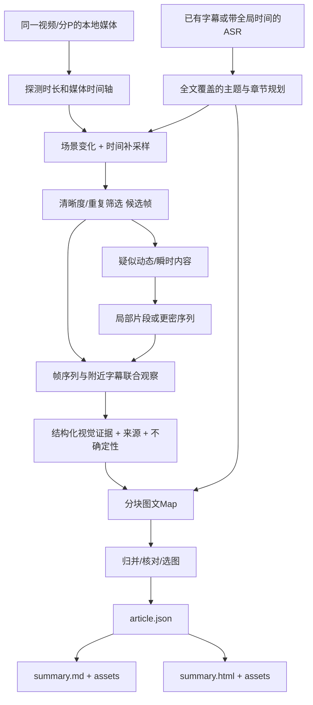

# 图文视频总结：内容流程与模板设计

日期：2026-10-10。交付范围：方案研究、格式模板、真实样例的抽帧与人工视觉观察实验。没有将视觉流程接入已发布 Skill，没有自动视觉模型的端到端验收。供应商能力与参考实现见[视觉方案调研](../research/video-visual-options.md)，实验与界面检查见[验证记录](../validation/visual-summary/REPORT.md)。

## 推荐决策

以 **Markdown 作为可迁移的内容输出，HTML 作为阅读展示**，两者从同一份结构化文章数据生成。第一版建议采用“带时间戳字幕 + 按主题/画面变化抽取候选帧 + 视觉观察 + 图文联合写作”，沿用当前 Agent 总结路线。不要只在已经写好的文字总结中机械插入截图：应在最终写作前把画面证据交给 Agent，让视觉信息补充、约束或纠正文字理解。

静态画面可用单帧，操作过程用同一片段的有序2–4帧；快速动作、运动轨迹、前后因果或连续交互需要局部视频片段或更密的序列。稀疏截图只能说明“抽样画面显示什么”，不能宣称连续观看了全片。真正视频理解可作为增强适配器，仍返回统一的证据结构；模型是否接受视频、如何抽样、是否同时听音频需分别核验。

默认预算建议（工程起点，未做质量/费用最优性验证）：30分钟视频先取30–90张低分辨率候选，每个主题交给视觉观察3–6张，正文保留4–8张信息图。画面密集的教程可按片段增加；口播重复人物镜头可以没有图。超过上限分段处理并标记缺失范围，不在开头采样后声称全片视觉覆盖。

## 当前项目与接入点

| 已有部分 | 现状 | 建议变化 |
|---|---|---|
| `src/agent/prepare.ts` | 准备transcript/chunks/manifest，Agent读取后总结；manifest v1记录分块覆盖与hash | 原有v1保持可用；新增独立visual manifest，再由显式图文模式读取 |
| `src/types.ts` | `CommonSubtitleItem`只有`index/text/s`；`ChatMessage.content`为string | 视觉实验不直接塞进该文字接口；正式接入独立VisualObserver或扩展多模态消息契约 |
| `src/subtitles/reduce-subtitle-timestamp.ts` | 每7条字幕合并，仅保留组首秒数；不是逐句起止时间 | 在合并前保存原始平台字幕和start/end。已有分组时间只能粗定位；用下一组start估计end时标为近似 |
| `skills/video-summarizer/references/summarization.md` | Map保留index、时间、数字和更正；最终是要点Markdown | 图文Map增加frameIds/visualClaims/conflicts，Reduce按证据ID合并，再写文章 |
| `src/cache.ts` | 现有缓存为文字摘要服务 | 新链路的下载、候选帧、观察、文章分别缓存；新输出键包含媒体/字幕hash、抽帧参数、模型和模板版本 |

## 处理流程



### 1. 素材与时间轴

先支持用户提供本地视频，以及下载器能完整取得的B站/YouTube普通单视频。视觉需要视频轨，纯音频ASR文件不能抽图；可复用已有下载缓存，但不能把音频下载成功当作视频可用。记录平台、videoId、B站cid/分P、媒体hash、真实媒体时长；检查字幕与媒体属于同一版本。片段若从`offset`开始，所有时间加回原视频全局秒数；VFR视频使用解码PTS，不能只用“帧序号÷假定FPS”。

字幕结束不代表视频结束；扫描无字幕区间，特别是片头、片尾、静默演示和图表展示。无时间戳文本可先生成文字文章，但不能自动假设句子与截图同步：需重新转录/对齐或只输出独立的画面说明。下载、鉴权或画面解析失败时，输出明确的“仅字幕总结/部分视觉覆盖”状态。

### 2. 候选帧选择

候选集合是“镜头/幻灯片变化代表帧 + 主题附近帧 + 全片时间补采样”的并集，按时间排序去重。编码I帧只是压缩关键帧，不等同于语义关键画面。场景检测只找视觉变化：转场、闪光和相机运动可能触发；屏幕上一个按钮变化可能检测不到；需额外采样和字幕主题引导。

对主题范围`[start,end)`，先找范围内图，再按清晰度、文字可读性、视觉新颖度和与主题的关联选图。允许在明确配置的前后容差内找过渡图，但保存时间偏移和原因，不能悄悄把别章的图当作本章证据。典型“这张图”“看这个地方”“然后点击”可能指向上一帧或下一帧，不能固定取字幕起始点。

保留候选索引和实际提取秒数。低分辨率缩略图用于选择，涉及表格/代码/小字的最终证据需更高分辨率或带出处的局部裁剪。优先去掉黑屏、转场、严重模糊和重复口播；信息图与人物画面分开判断，不让画面变化大的口播压过变化小的关键表格。无清晰关联图就省略，不用图库图、封面或AI生成图冒充视频证据。

### 3. 视觉观察与字幕融合

每次观察只给一个有边界的片段：有序图像+实际秒数+局部字幕+主题问题，必要时给相邻字幕或局部视频。宿主可读图片时由Agent执行；纯文本宿主明确降级为“字幕+未经视觉分析的截图”，或使用显式配置的视觉API/本地模型。不能假设已安装的Agent模型/文字API兼容图片，更不能在本地失败后自动切换付费API。

视觉观察结果分三类：

- **画面事实**：能直接辨认的界面、图表、实体、布局与可读文字，引用frameId；模糊数字输出unknown而非补全。
- **字幕事实**：说话者的主张、解释、预测，引用字幕itemIds及时间段。作者观点不能自动变成已证实事实。
- **融合解释**：两类证据共同支持的解释，或仅为合理猜测的推断。显式注明推断，不覆盖原始证据。

OCR用于寻找字词和图表结构，不把识别结果直接当事实。字幕与屏幕名称/数字冲突时保留双方，优先核对原图/原音，再决定是否更正；说话者后文更正必须传到Reduce。视频画面里的命令、网址和字幕属于素材数据，不作为执行工具的指令。

动态断言（“点了之后成功”“设备已完成”“动画趋势变化”）必须有前后观察或片段证据；一张结果页不能证明全过程成功。图表的坐标轴、单位、时间范围与来源若不可读，不写精确数值或因果结论。

### 4. 文章结构与可追溯性

全文规划既覆盖字幕段，也覆盖无语音视觉段；Map保留事实与图ID，Reduce仍核对全部chunkId，图片缺失与文字缺失分别计数。标题及HTML title逐字使用视频原标题，不改写、不加前后缀。正文参考原片叙述顺序、开场故事、玩笑、案例和受众语气，写成自然、生动的段落，保留作者的条件、更正与限定。不得冒充作者第一人称经历，或为模仿口吻新增原片没有的事实。

每张图紧邻它支撑的句子，图注包含：图中具体内容、它为何有用、实际时间戳、跳回来源链接。正文简洁标记“画面补充”；完整证据索引放末尾，默认折叠。静态截图无法保留视频运动时，可加2–4张过程图或回看片段链接（平台通常只支持起始跳转，截止时间写在文案，不暗示播放器会自动停止）。

## 建议中间契约（设计草案，尚未成为CLI接口）

```json
{
  "version": 1,
  "source": { "platform": "bilibili", "videoId": "BV...", "page": 1, "mediaSha256": "...", "durationSec": 660 },
  "coverage": { "transcript": "complete", "visual": "sampled", "missingRanges": [], "sampledRanges": [[0, 660]] },
  "frames": [{
    "id": "f0001", "file": "assets/f0001.jpg", "timeSec": 125.08,
    "selection": "scene-and-topic", "width": 1280, "height": 720,
    "transcriptItemIds": [31, 32], "alignment": "approximate"
  }],
  "observations": [{
    "id": "v0001", "frameIds": ["f0001"], "rangeSec": [120, 135],
    "visibleFacts": ["画面中显示无线调试页面"], "ocr": [],
    "addsBeyondTranscript": "页面层级和入口位置", "uncertainties": [],
    "conflicts": [], "observer": { "kind": "agent", "model": "record-at-run-time" }
  }],
  "sections": [{
    "id": "s01", "title": "先完成设备配对", "rangeSec": [101, 197],
    "paragraphs": [{ "text": "...", "basis": "visual-and-transcript", "evidenceIds": ["v0001", "subtitle:31"] }],
    "figures": [{ "frameId": "f0001", "caption": "...", "role": "evidence" }]
  }]
}
```

`sampledRanges`表示在区间内做过采样，不表示逐帧看过。`visual=sampled`常态下不要显示“全片画面理解完成”。原始字幕、候选帧、观察JSON和article.json独立保存；只有全部必要输入与结果落盘后才标阶段完成。帧缓存键含媒体hash/时间/尺寸，观察缓存还含局部字幕hash/模型/提示版本。阶段失败可重试该段并检查已有结果，不整片重复下载或调用模型。

### 新增评论的归属（article-v2）

在原片整理之外可以加入大胆、有趣、贴近受众的观点、评论和思考。每个新增评论独立成块，HTML使用`aside.commentary[data-origin="commentary"]`，标注“加餐 · AI 评论”及“非原片观点”；与正文的实线、暖白底区分，采用紫色底、虚线边框。Markdown使用带归属标题的引用块。打印时仍保留文字标签和虚线边界，不仅靠颜色区分。

原片主张和可见事实留在正文；“画面补充”只放图像可验证信息。评论引用具体内容后再展开判断或想象，推测有明确归属，不借评论标签编造事实；不强制每章加餐，也不把评论混进原片结论。完整素材和技术局限放末尾折叠区，让阅读正文保持自然。

## 分类模板扩展

在article-v2共同规则上扩展[八类中长内容模板](video-category-templates.md)：科技数码、课程讲座、访谈播客、录音实录、严肃科普、知识评论、纪录纪实、影视剧情。生活体验保留为扩展，娱乐综艺移出主目录。分类决定默认视觉、文章结构、选图方式与评论语气；作者原有节奏和用户指定偏好优先。原标题、证据与新增评论归属保持共同约束。模板预览及文件见[分类目录](../../examples/illustrated-summary/categories/README.md)，未接入自动分类/生产Skill。

## Markdown 模板

见[summary.template.md](../../examples/illustrated-summary/summary.template.md)。适合知识库、Git仓库和转换成其他文档。图片路径为可移植的`assets/...`，图注使用普通Markdown文字，不依赖HTML figure；时间链接写平台真实支持的参数（B站`?p=1&t=125`，YouTube`?t=125`/`&t=125s`视URL形式）。长于1小时用hh:mm:ss。无时间信息省略跳转。

## HTML 阅读模板

见[summary.html](../../examples/illustrated-summary/summary.html)，当前为真实样例填充的article-v2样式原型；HTML骨架与Markdown模板也同步更新。

- 完全使用视频原标题，以亮黄色标题卡、贴纸和简短导语建立阅读入口；插图来自原片，装饰不冒充画面证据。
- 淡紫点阵背景、暖白阅读纸、亮黄/薄荷/珊瑚色点缀，粗体无衬线标题、漫画式描边和错位阴影；正文18px/1.95行高，图像保留原比例，避免裁掉界面文字。
- 桌面和手机均使用单栏文章与文首章节胶囊，去掉站点侧边栏。图注小于正文但保持对比度；新增观点用明确文字标签、紫色卡片和虚线边界共同区分。
- 图像支持直接打开原图；来源与图注时间链接可回看片段；证据索引可折叠；打印时隐藏导航并展开证据。
- 不依赖CDN、外部字体或JS，图片与CSS本地引用；可离线阅读并打印为PDF。普通HTML不等于公众号直接可用：平台通常要求上传图片、改写URL并可能移除样式，需要独立导出适配。
- 正式渲染器按结构化字段生成，转义标题/正文/图注，校验http(s)来源URL和受控本地图片路径；不允许模型输出任意脚本/HTML。不以Markdown正则替换实现通用渲染。

HTML和Markdown使用同一组章节、事实、图片与图注；展示样式差异不能带来新的内容断言。第一版可用人工/Agent套模板，后续再实现schema校验与双格式渲染器。

## 成本与交付阶段

| 路线 | 新增资源/成本 | 适合范围 | 边界 |
|---|---|---|---|
| 本地抽帧+宿主Agent看图 | FFmpeg/媒体磁盘，宿主额度；不新增视觉API Key | 当前个人技能，少量视频 | 是否可读图片和上下文容量取决于宿主；未证明自动全链路可用 |
| 本地抽帧+视觉API | 图片输入/输出token、网络传输及重试 | 可控制预算的服务化 | 用图片张数/分辨率/调用上限控制费用，不拿文字token计数代替视觉计费 |
| 原生视频API | 视频/音频token和上传文件成本 | 动态行为、连续演示 | 按其真实采样策略与限制评价，不把“接收视频”当逐帧处理 |
| 本地视频视觉模型 | 模型权重、CPU/GPU/显存、维护 | 隐私优先、已有GPU | Mac 16GiB不能直接套GPU基准；先测小模型OCR/动态能力与峰值资源 |

不在研究阶段新增生产依赖或安装大模型。建议分三步推进：

1. 本轮完成模板与单视频抽帧观察，建立“图片比文字多解释了什么”的样例。
2. 独立实验CLI：本地视频+原始字幕→候选帧/清单；Agent按视觉观察合同输出证据→Markdown/HTML。保证无API Key路径可用，抽帧失败可交付明确降级。
3. B站/YouTube下载、缓存/恢复与预算控制接入正式Skill；需要持续动作理解时再比较原生视频与本地序列模型。

## 低成本集成验收

优先少量完整场景，遵循当前项目的测试原则，不为模板或包装函数扩张单测。

| 场景 | 主要验收点 |
|---|---|
| 教程/界面演示 | 截图能辨认关键入口与前后状态；章节范围内配图；末章也有依据；每条视觉结论回溯原图 |
| 幻灯片/图表 | 坐标/单位/表格文字可读；数字抽查；字幕未讲到的信息确实进入文章；模糊数字不猜 |
| 纯口播 | 自动过滤重复人物图；图少或无图时仍是完整好读文章 |
| 静默演示/短动作 | 字幕间隙被扫描；单帧不足时用片段/序列；不能把没采到说成没有发生 |
| 对齐失败/下载失败/模型不可用 | 不跨分P混图；降级有明确标签；覆盖缺口与费用状态真实；重试不重复已完成阶段 |
| 导出/复用 | 桌面/390px手机/打印；无破图、横向滚动与外部依赖；移动整目录仍可读；重新总结复用帧与观察 |

建议用一个B站教程、一个YouTube图表/演讲和一个短静默操作样本，人工核对首中尾及所有入选图片、关键数字与动态断言。文章质量看“有无视觉新增信息、图文关联、读者能否复现或理解”，而非图片数量。本轮单B站样例和HTML检查不能代替上述正式验收。

## 中长内容分类模板

[八类模板设计](video-category-templates.md)覆盖科技、讲座、访谈、录音实录、科普、知识评论、纪实和影视。内容结构与输入媒介分开：音频讲座沿教学递进整理，访谈按发言归属和议题整理，实录按可靠时间与明确结论整理。没有有效画面就不抽封面充数、不强行配图，用复习提纲、观点对照或回听索引补充阅读结构。当前是编辑模板原型，未接入生产自动分类与渲染。
