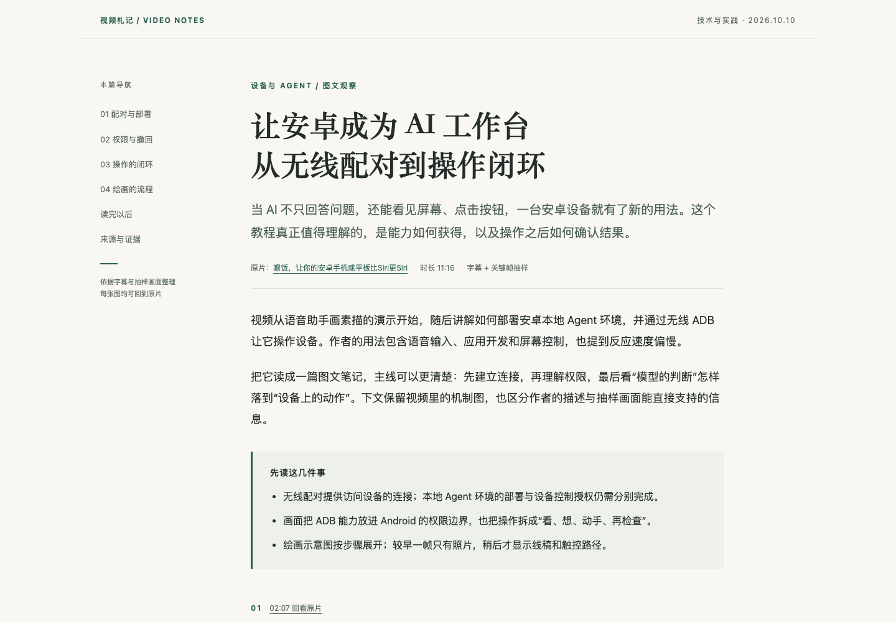
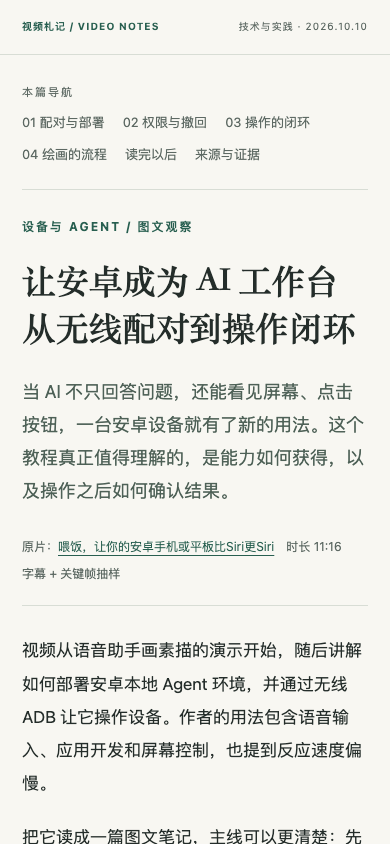

# 图文总结抽帧与排版实验

日期：2026-10-10。目标：用一个已有字幕样例，验证本地视频抽帧、宿主 Agent 视觉观察和图文文章排版能形成具体可读的结果。这是单样例实验，**不是生产视觉流水线或模型准确率验收**。

## 样例与实际结果

视频：[BV1KLhi6oEh5](https://www.bilibili.com/video/BV1KLhi6oEh5/)，标题《喂饭，让你的安卓手机或平板比Siri更Siri》。复用[已有字幕输入](../../../examples/samples/BV1KLhi6oEh5.input.txt)，完整阅读其分组文字（0–670.16秒），未重新获取字幕或独立听校。

通过现有yt-dlp匿名下载480p视频轨，852×480，耗时6.624秒；ffprobe媒体时长675.783688秒，页面元数据675.8秒。FFmpeg版本9.0.2。媒体位于忽略目录`review/visual-summary/source.mp4`，没有提交完整视频、签名URL或Cookie。

先用每30秒采样的contact sheet观察画面分布，过滤重复口播，再定点提取6张JPEG原帧，使用`-copyts`和`showinfo`记录实际PTS。每张都由宿主Agent通过图像工具查看，随后结合附近字幕写出图注与画面补充。没有安装/调用独立VLM，没有付费视觉API请求；宿主读图仍使用Agent模型额度。

| 画面 | 实际PTS秒 | 入文作用 |
|---|---:|---|
| 已配对授权连接图 | 190.016688 | 画面返回/操作执行的方向与设备角色 |
| Android权限边界 | 410.016687 | 两类能力置于Android权限边界内，不等于无限权限 |
| 授权撤回图 | 436.016687 | 关闭无线调试与删除配对信任为两个动作；图上显示关闭状态 |
| 操作闭环图 | 533.016687 | 看、想、动手、再检查的四环节，以及读取新状态 |
| 绘画流程较早一帧 | 545.016687 | 只有照片，尚无完整中间流程 |
| 绘画流程稍后一帧 | 555.016687 | 照片→线稿→触控路径；笔压/灰度标签 |

[证据清单](../../../examples/illustrated-summary/evidence.json)记录媒体与图片hash、请求时间/实际PTS、附近字幕的近似范围、可见事实及观察方式。分组字幕只提供start；本文没有把下一组start当作精确句尾。

本实验发现：请求时间落在合适主题内也可能得到未展开的动画或口播。最初候选中，425秒是人物镜头，525秒的闭环图尚不完整，545秒的绘画图仅有照片；检查邻近时间后分别保留完整机制图，并用545/555两帧说明抽样局限。这个结果支持“先筛图和读图，再联合写作”的必要性，不证明自动选择器已经实现。

## 可查看交付

- [HTML文章](../../../examples/illustrated-summary/summary.html)：中文报道式标题、段落、原帧、图注、时间回看链接、移动目录、证据折叠与打印样式。
- [同内容Markdown文章](../../../examples/illustrated-summary/summary.md)：同6张图与图注，方便迁移到知识库。
- [HTML骨架](../../../examples/illustrated-summary/summary.template.html)和[Markdown模板](../../../examples/illustrated-summary/summary.template.md)：复用占位结构。HTML的CSS为本地文件，没有外部字体、JS或CDN。

## 浏览器集成检查

使用已有Playwright依赖和系统Chrome，在`file://`路径打开本地HTML；无需启动Web服务。

[检查结果](ui-checks.json)：1440×1000桌面与390×844手机下，6张图全部加载，均无横向溢出；目录锚点有效；证据折叠可展开；打印媒体下闭合的证据列表也可见；HTML与Markdown都包含同6张图片。实际生成打印PDF保留在`review/visual-summary/summary.pdf`，未做独立PDF视觉验收。完整页面截图也保存在该忽略目录。

检查过程中发现懒加载图片会在直接全页截图/打印时尚未加载，因此样例改为普通图片加载；6张图片合计约260KiB，无需为该规模延迟加载。已视觉检查桌面与手机首屏，并查看实际关键帧；没有扩大函数单元测试。生产源码未改动，因此本轮不重复跑生产单测以替代文章检查。

桌面首屏：



手机首屏：



## 复现抽帧

以下是本次使用的形式；先创建新的实验输出目录，安装/鉴权不是此报告的一部分：

```sh
yt-dlp --ignore-config --no-playlist --retries 1 --socket-timeout 20 \
  -f 'worstvideo[height>=480]/worstvideo/worst' \
  -o 'review/visual-summary-new/source.%(ext)s' \
  'https://www.bilibili.com/video/BV1KLhi6oEh5/'
ffmpeg -nostdin -i 'review/visual-summary-new/source.mp4' \
  -vf 'fps=1/30,scale=320:-1,tile=5x5' -frames:v 1 \
  'review/visual-summary-new/contact-sheet.jpg'
ffmpeg -nostdin -copyts -ss 555 -i 'review/visual-summary-new/source.mp4' \
  -vf showinfo -frames:v 1 -q:v 2 \
  'review/visual-summary-new/drawing-pipeline.jpg'
```

实际格式可能不是mp4，后续命令需对应真实文件。示例下载选择偏低清晰度以降低实验成本，不能保证任意源至少480p；小字识别应提高视频清晰度或局部放大。contact sheet用于选择，不能把缩略图当精确文字识别输入。提取日志中的实际PTS要绑定到最终帧索引。

## 限制与下一轮验收

1. 本轮只验证一个B站普通公开视频；YouTube下载、更多分P/鉴权情况未验证。
2. 画面是稀疏抽样，未连续观看全片；示意图说明机制，不证明作者设备上的每次操作成功。文章保留这项边界。
3. 字幕含软件名称、端口等疑点，文章不据此生成可直接执行的部署命令；没有统计OCR/ASR准确率。
4. 每30秒采样会漏短画面；本轮邻近帧检查依赖Agent判断，没有自动场景检测/语义选图/VLM批处理代码。
5. HTML和Markdown是人工/Agent套模板的原型，没有生产schema校验、双格式渲染器、断点恢复和视觉费用控制。

下一轮按[方案的集成验收](../../design/illustrated-summary.md)补一个YouTube课件/图表样例与一个短静默动作片段，验证至少两条字幕之外的画面信息，以及顺序/前后状态证据、失败降级与缓存恢复。
