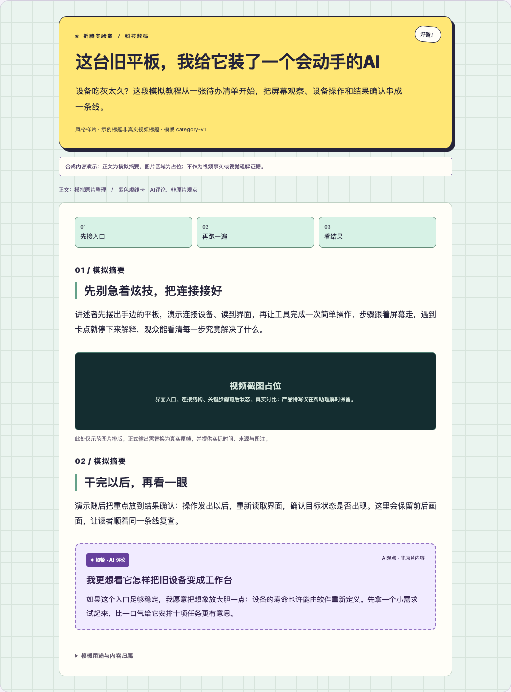
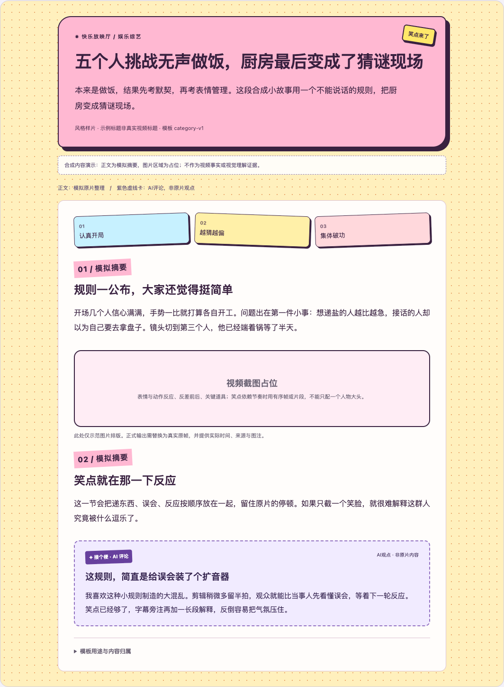
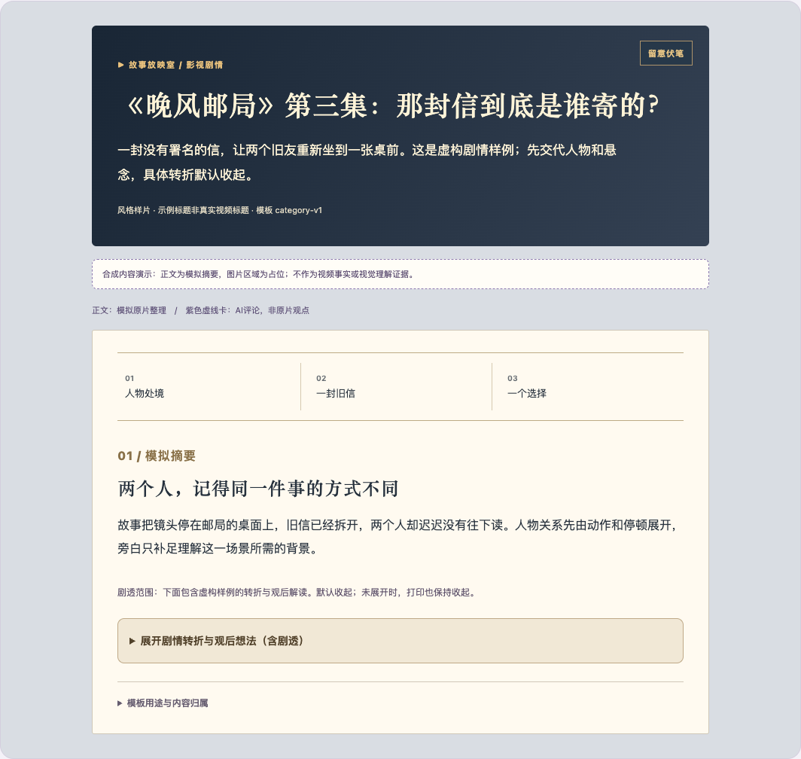
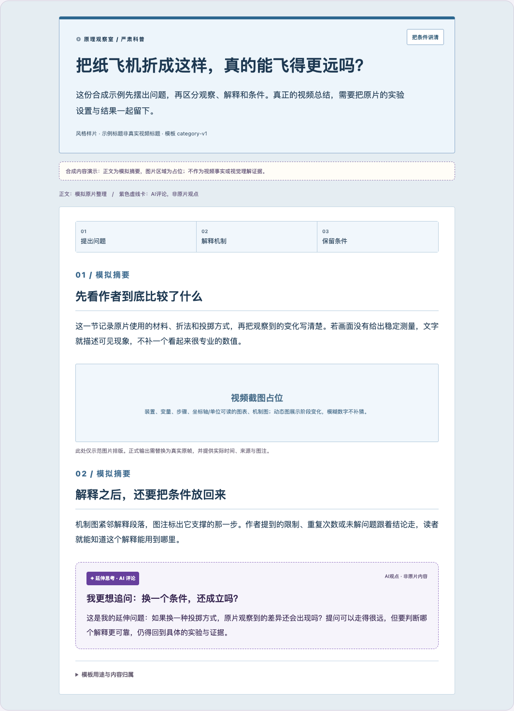
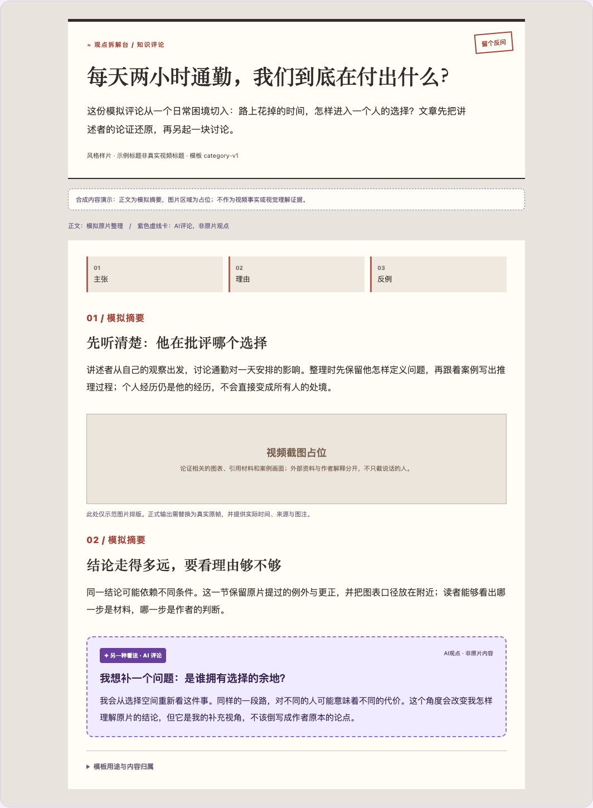
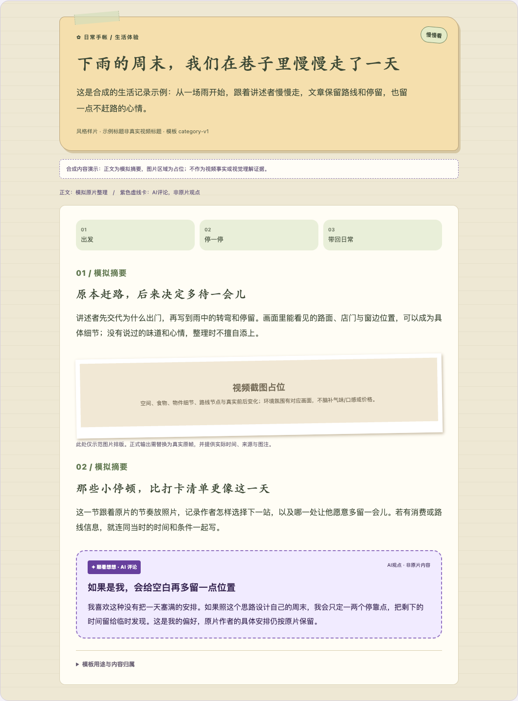

# 六类编辑模板原型验收

日期：2026-10-10。范围：模板、写作合同、合成预览和浏览器行为。未接入生产分类器/Skill，未用六类真实视频验证总结质量。原有科技真实样例未覆盖或重写。

## 交付

- [可切换预览](../../../../examples/illustrated-summary/categories/index.html)：六类视觉、模拟摘要、AI评论卡；可直接file://打开，无服务器/外部依赖。
- [配置与模板](../../../../examples/illustrated-summary/categories/README.md)：6个HTML骨架、6个Markdown模板，共用结构CSS与分类CSS；profiles.json为事实源，生成器可重建。
- [分类和写作规则](../../../design/video-category-templates.md)：主类、表达模式、作者语气、混合内容、选图策略、评论尺度、剧透和共同约束。

合成内容/模拟标题/截图占位在预览中明确标识；不构成原片事实或视觉理解证据。科技真实样例的字幕、图片与文章仍使用原有文件。

## 检查结果

使用已有Playwright和系统Chrome，在file://下执行集成检查。结果见[checks.json](checks.json)。没有新增生产依赖、按函数扩张单元测试或运行其他正在修改的生产模块。

| 检查 | 结果 |
|---|---|
| 六类切换 | 主视觉、行文介绍、示例标题、内容、评论标签和模板链接随选择变化；始终只有一个按钮选中 |
| 桌面1440px、手机390px、窄屏320px | 6类均无横向溢出；评论采用虚线边界，维持独立归属 |
| 键盘与深链接 | 按钮可用Enter激活；选择写入URL hash |
| 标题 | 每个预览H1与模拟标题逐字一致；6个HTML骨架的title和H1使用相同原标题占位符 |
| 评论 | 6类骨架都有独立data-origin=commentary；预览标签含AI归属和非原片说明 |
| 剧透 | 剧情转折/截图/观后评论默认隐藏；显式展开可读；打印保持展开状态，不自动展示隐藏内容 |
| 素材说明 | 可折叠/展开；打印时来源说明可见 |
| 骨架样式 | 6个HTML骨架均加载正确data-theme和本地CSS |
| 浏览器 | 无pageerror；桌面六类截图已逐一视觉检查 |

手机完整截图保存在忽略目录`review/visual-summary/categories/`。模板骨架有待替换的图片和URL占位符，它们不是已填充文章；不以占位图加载状态衡量真实视频证据可用性。

## 六类实际样式

科技数码：

娱乐综艺：

影视剧情（剧透区默认关闭）：

严肃科普：

知识评论：

生活体验：

## 后续真实验收

各类至少选一个真实样本，从字幕/画面走到完整文章，检查作者语气、素材覆盖、选图关联、评论归属及分类是否合适；科普另查条件/单位，知识评论另查更正/反例，剧情另查剧透。当前浏览器通过只证明原型样式和行为，不证明自动分类或六类内容质量已验证。
