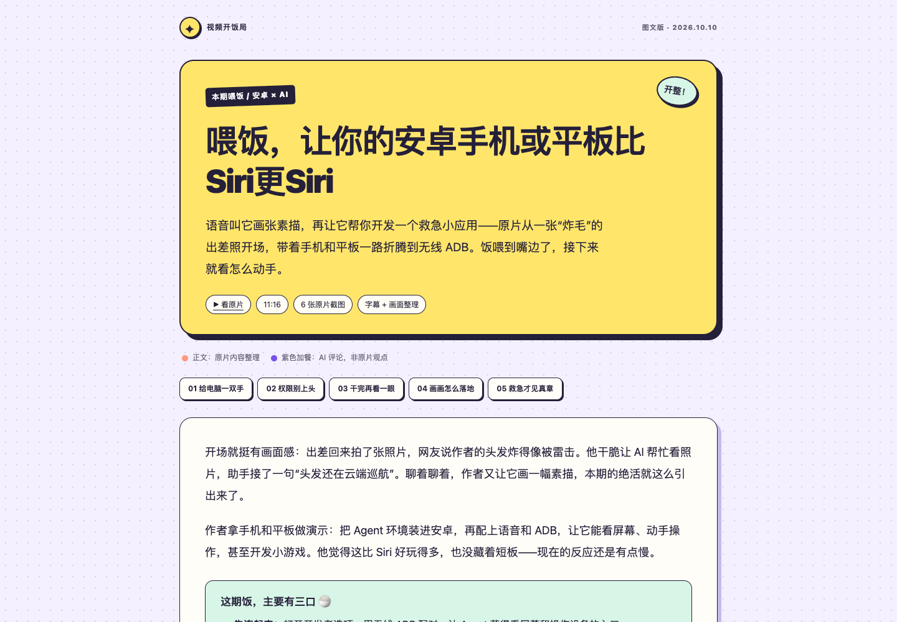
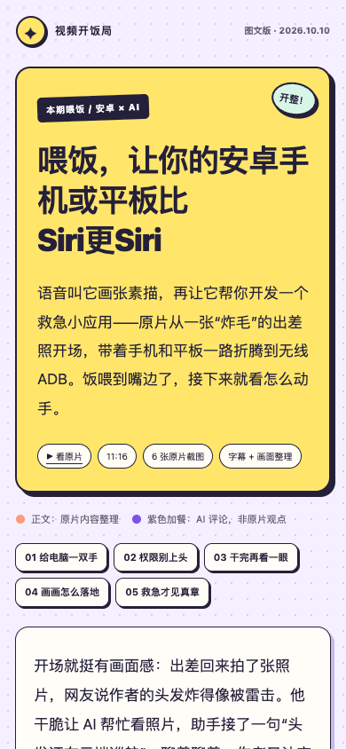
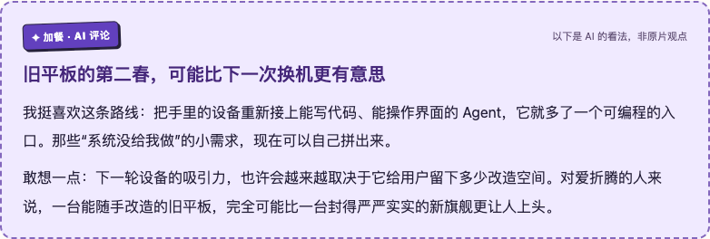

# 图文总结 article-v2 改版

日期：2026-10-10。范围：在已验证的单视频图文样例上，改版文章样式、行文方式和评论归属；复用原有6张真实截图，未改视频获取/视觉流水线、生产源码或已发布Skill。

## 改版要求与结果

| 要求 | 新版实现 |
|---|---|
| 更活泼、娱乐化，减少博客站感觉 | 单栏阅读纸，亮黄色标题卡，淡紫点阵背景，贴纸、漫画描边、错位阴影、文首章节胶囊；去掉侧边栏 |
| 尽量参考原片内容和行文方式 | 保留“炸毛照片/素描开场→无线配对/部署→权限提醒→操作闭环→绘画流程→救急应用”的叙述顺序；自然段落，保留玩笑、例子与现实限定 |
| 追加有趣、可以激进的观点 | 4处加餐：旧设备的改造空间、停止开关的产品价值、结果确认、一次性软件；每处来自具体原片内容，再明确表达个人判断/推测 |
| 观点与总结样式分开 | HTML `aside.commentary[data-origin="commentary"]`，紫底虚线框，标签“加餐 · AI 评论”及“非原片观点”；Markdown用带同样归属说明的引用块 |
| 标题完全使用原片原标题 | HTML title、H1、Markdown H1均为“喂饭，让你的安卓手机或平板比Siri更Siri”，与素材清单的原始title逐字核对；排版span不改变文字 |

正文中的作者观点仍归作者，画面补充只写图像可支持的信息。新评论不是作者原话，也不作为未来趋势的事实断言。素材与技术局限放文末折叠区，不反复打断正文。原帧、PTS、hash及来源沿用[素材证据](../../../examples/illustrated-summary/evidence.json)。

同步更新：[HTML样例](../../../examples/illustrated-summary/summary.html)、[Markdown样例](../../../examples/illustrated-summary/summary.md)、[HTML骨架](../../../examples/illustrated-summary/summary.template.html)、[Markdown模板](../../../examples/illustrated-summary/summary.template.md)、[设计规则](../../design/illustrated-summary.md)。

## 验证

已有Playwright+系统Chrome，在file://下执行浏览器集成检查，不启动服务器、不添加依赖或单元测试。结果见[checks.json](v2/checks.json)：

- 1440px桌面、390px手机、320px窄屏均无横向溢出，6张图片加载成功，所有目录锚点存在。
- document.title/H1与素材原始title完全相同；Markdown标题亦完全相同，含同6张图片、同4处评论引用块。
- 4个评论卡均有独立归属标记和虚线边框；证据区可展开。
- 打印时保留评论标签与虚线；闭合的证据列表也可见。实际打印文件保留于忽略目录`review/visual-summary/summary-v2.pdf`，没有做独立PDF视觉验收。
- 浏览器无pageerror；已视觉检查桌面首屏、手机首屏和评论卡。

桌面：

手机：

评论卡：

本轮检查聚焦静态文章、归属和排版，不扩大到原片设备实操、连续动作理解、YouTube获取或自动模型质量验证。
