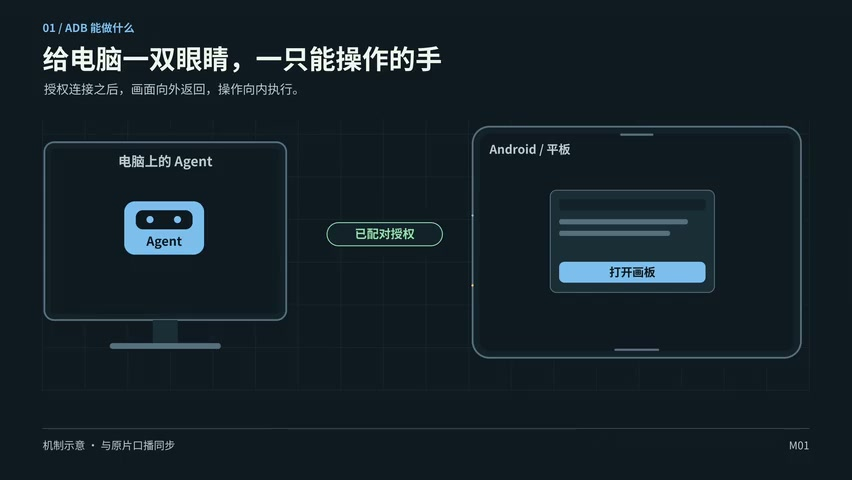
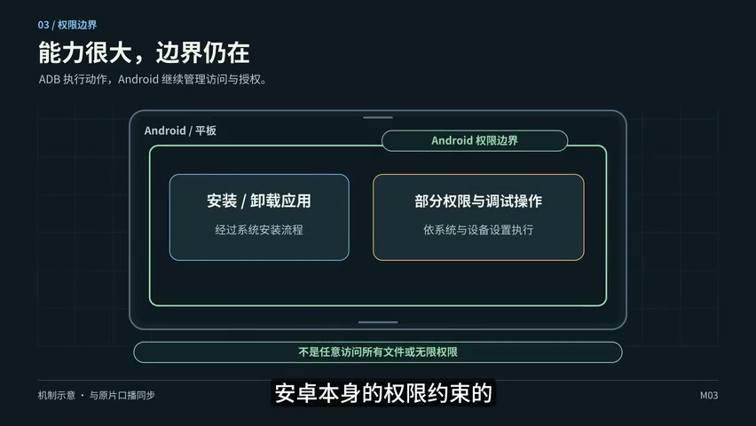
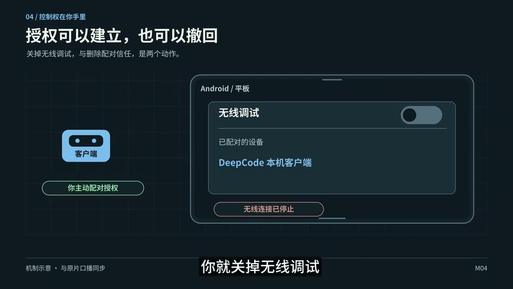
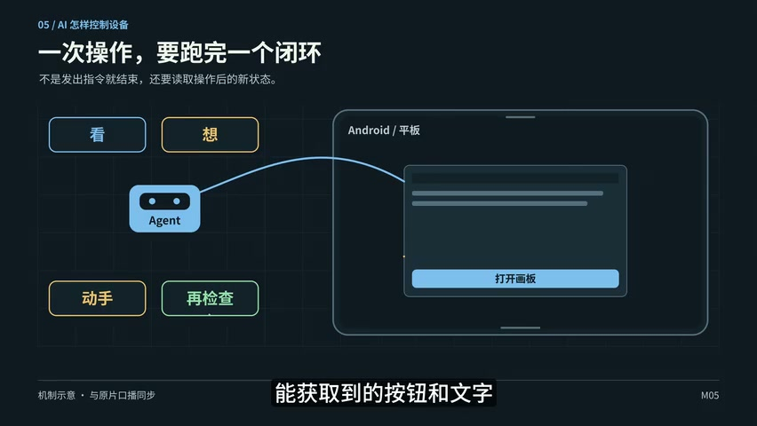
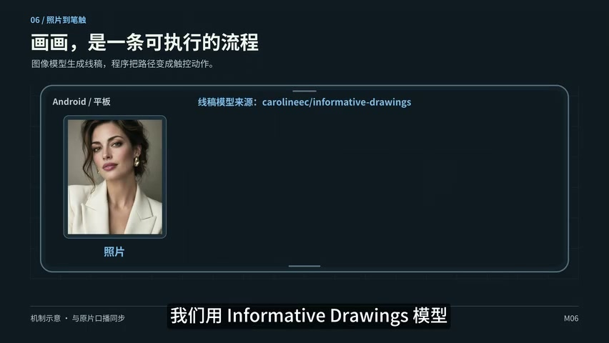
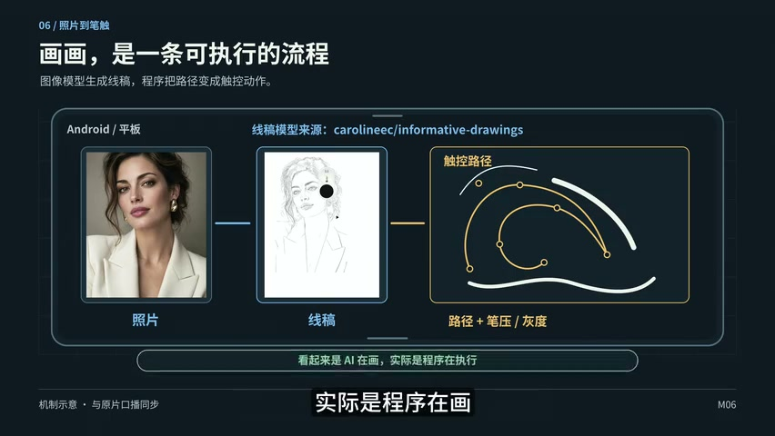

本期喂饭 / 安卓 × AI

# 喂饭，让你的安卓手机或平板比Siri更Siri

语音叫它画张素描，再让它帮你开发一个救急小应用——原片从一张“炸毛”的出差照开场，带着手机和平板一路折腾到无线 ADB。饭喂到嘴边了，接下来就看怎么动手。

[▶ 看原片](https://www.bilibili.com/video/BV1KLhi6oEh5/) · 11:16 · 6 张原片截图 · 字幕 + 画面整理

**阅读标识：** 正文是原片内容整理；紫色加餐为 AI 评论，非原片观点。

开场就挺有画面感：出差回来拍了张照片，网友说作者的头发炸得像被雷击。他干脆让 AI 帮忙看照片，助手接了一句“头发还在云端巡航”。聊着聊着，作者又让它画一幅素描，本期的绝活就这么引出来了。

作者拿手机和平板做演示：把 Agent 环境装进安卓，再配上语音和 ADB，让它能看屏幕、动手操作，甚至开发小游戏。他觉得这比 Siri 好玩得多，也没藏着短板——现在的反应还是有点慢。

## 这期饭，主要有三口 🍚

- **先连起来：**打开开发者选项，用无线 ADB 配对，让 Agent 获得看屏幕和操作设备的入口。
- **再讲明白：**本地环境装好了，还得处理本机控制的配对；权限很大，撤回方法也得知道。
- **最后找用处：**画画、语音控制、写小应用。作者最有感的，是出差时那些只用一次却能救急的工具。

01[02:07 · 跟着做](https://www.bilibili.com/video/BV1KLhi6oEh5/?p=1&t=127)

## 给电脑一双眼睛，再给它一只手

教程先从开发者模式开始：找到系统版本，连续点几下，再进开发者选项打开 USB 调试和无线调试。无线配对页面会给出配对码、地址和端口，把这些交给同一局域网里的电脑 Agent，告诉它准备 ADB 环境，就可以往下做了。

连上以后，电脑能给设备装应用、传文件，能截图读按钮和文字，也能点击、滑动、打字。作者的比喻很直白：相当于给电脑一双能看见屏幕的眼睛，再加一只会动手的手。

*原片截图 图1 · 03:10。电脑和设备之间，连接的前提是“已配对授权”。[回看这段](https://www.bilibili.com/video/BV1KLhi6oEh5/?p=1&t=190)*

接下来就是构建、安装应用，再配置登录和语音等插件。作者还聊到一个顺手的小配件：蓝牙遥控器既有麦克风又有按键，可以开启语音、确认发送。整个玩法的趣味，就在于把身边这些东西接到一起。

真正有点绕的，是让设备里的 Agent 通过本机地址控制自己。原片强调配对界面要保持打开：有小窗就把两个界面放在一起，没有小窗可以请电脑 Agent 帮忙输入，让本地环境在后台配对。演示里的端口是当次参数，照着理解流程就好。

> **✦ 加餐 · AI 评论｜旧平板的第二春，可能比下一次换机更有意思**
>
> **以下是 AI 的看法，非原片观点。**
>
> 我挺喜欢这条路线：把手里的设备重新接上能写代码、能操作界面的 Agent，它就多了一个可编程的入口。那些“系统没给我做”的小需求，现在可以自己拼出来。
>
> 敢想一点：下一轮设备的吸引力，也许会越来越取决于它给用户留下多少改造空间。对爱折腾的人来说，一台能随手改造的旧平板，完全可能比一台封得严严实实的新旗舰更让人上头。

02[06:17 · 先听提醒](https://www.bilibili.com/video/BV1KLhi6oEh5/?p=1&t=377)

## 玩得开心，也得知道哪儿能踩刹车

讲到让 Agent 操作本机，作者先把风险摆上桌。AI 要是看不懂界面，可能在错误的 App 里发消息、改错设置，或者删掉它有权访问的文件。原片也提醒：安装、卸载和部分权限调整，仍受 Android 自己的权限约束。

*原片截图 图2 · 06:50。能力都放在 Android 的权限边界里，图底部特意注明不能任意访问所有文件。[回看这段](https://www.bilibili.com/video/BV1KLhi6oEh5/?p=1&t=410)*

用云端 API 时，作者尤其提醒隐私和资金界面别让它独自操作。不过，连接的前提是你主动配对授权；不想让它继续动手，可以关掉无线调试，或从配对列表删掉客户端。

*原片截图 图3 · 07:16。开关和配对信任是两回事，原片把这两个撤回动作分开讲。[回看这段](https://www.bilibili.com/video/BV1KLhi6oEh5/?p=1&t=436)*

> **✦ 加餐 · AI 评论｜“随时叫停”这件事，应该和炫技同样显眼**
>
> **以下是 AI 的看法，非原片观点。**
>
> 我会把好用的停止开关当成 Agent 产品的核心体验。演示越酷，越容易让人把权限一路开到底；真到它开始操作相册、聊天和账户，用户才会想起来问：刚才究竟授权了什么？
>
> 我的偏好很明确：大胆给工具扩能力，同时把收回能力的入口放到手边。能玩得开，也能一把拽回来，这样才敢长期用。

03[08:34 · 原理拆开看](https://www.bilibili.com/video/BV1KLhi6oEh5/?p=1&t=514)

## 看、想、动手，再检查

原理讲开以后，其实没那么玄。Agent 先通过截图或界面文字判断现在在哪、下一步干什么，再执行点击、滑动和输入。做完之后，重新看一眼有没有成功。

*原片截图 图4 · 08:53。四个环节都在图里，“再检查”也占一格。[回看这段](https://www.bilibili.com/video/BV1KLhi6oEh5/?p=1&t=533)*

1. **看与想：**读到当前界面，判断位置和下一步。
2. **动手：**把判断变成点击、滑动或输入。
3. **再检查：**重新读取状态，看看事情到底办成没有。

> **✦ 加餐 · AI 评论｜最想给它加的技能：少说“搞定了”，多看一眼**
>
> **以下是 AI 的看法，非原片观点。**
>
> 我甚至觉得，“再检查”值得单独做一场演示。按钮没点中、页面还在转圈、焦点跑到另一个窗口，这些小岔子最能暴露一个 Agent 有没有真正在办事。
>
> 如果要押一个长期有价值的方向，我会押“把结果确认做扎实”。它看起来没那么炸裂，但能把玩起来很酷的工具，推向每天真能用的工具。

04[09:02 · 画画怎么来的](https://www.bilibili.com/video/BV1KLhi6oEh5/?p=1&t=542)

## 一句“帮我画画”，背后是一串工序

开场的素描演示，到这里交代了做法：用 informative drawings 模型把照片变成线稿，再转成触控路径，配合模拟笔压和灰度，表现笔触的粗细深浅。作者也点明，画面看着像 AI 在画，实际执行绘画的是程序。

🎞 同一段画面，往后看十秒

*原片截图 图5 · 09:05。先放进一张照片。[回看](https://www.bilibili.com/video/BV1KLhi6oEh5/?p=1&t=545)*

*原片截图 图6 · 09:15。线稿、触控路径和笔压 / 灰度都出现了，完整工序一眼能看明白。[回看](https://www.bilibili.com/video/BV1KLhi6oEh5/?p=1&t=555)*

**画面补充** · 这两张图记录的是示意图逐步展开。照片、线稿和触控路径的对应关系可直接看见；实际绘画的连续过程需要回看原片。

其他应用也可以沿着这个思路做：把问题拆成一组设备操作，再封装成专门的 Skill。作者的重点，是把已有模型、程序和操作入口组合起来，让一个具体需求能真正跑完。

05[09:35 · 出差的救急时刻](https://www.bilibili.com/video/BV1KLhi6oEh5/?p=1&t=575)

## 只用一次，也可以很值

作者讲得挺坦诚：他还没发现多少 AI 操作手机特别有用的场景。但平板就不同了。有次出差没带电脑，才发现处理灰片用的 LUT 留在旧电脑里，iPhone 拍的素材往平板上传也不方便。

怎么办？让平板里的 Agent 临时开发“救急应用”。作者举的例子，是开启一个服务，扫码上传素材，再给素材套上 LUT。这些工具可能只用一次，可卡在当时那个节骨眼上，就特别刚需。

所以视频最后又回到安卓的自由度：作者觉得它在 Agent 时代能玩出更多花样，甚至值得在 ADB 上再做一个更适合 Agent 的 CLI。几年前的老设备，也可以拿出来继续折腾。

> **✦ 加餐 · AI 评论｜敢想一点：以后我们的 App，会不会用完就散？**
>
> **以下是 AI 的看法，非原片观点。**
>
> “只用一次的应用”是这期最戳我的地方。以前遇到小麻烦，我们常常得先找产品、找替代方案、适应别人的流程。现在可以想象另一种日常：遇到问题，现场做一个刚好够用的小工具，解决完就收工。
>
> 我愿意把这个方向想得激进一点：个人软件的价值，可能越来越接近“此刻替我省了多少麻烦”。下载量、留存率、每天打开几次，那套标准未必适合评价这种救急工具。一次就够，前提是那一次真的把你救了。

## 这顿饭吃完，带走什么？

- 原片的路线是开发者选项、无线 ADB 配对、部署本地环境，再处理本机控制的授权。
- 设备操作按“看、想、动手、再检查”来组织；停止方法包括关闭无线调试或删除配对。
- 作者既展示玩法，也保留了速度偏慢、手机场景尚不丰富的现实感。
- 平板上的救急应用，是作者觉得真正有用的一块；有旧设备、有具体小需求，就有折腾的空间。

## 素材出处、时间与整理说明

正文依据仓库已有字幕与6张真实视频帧整理，尽量保留原片的叙述顺序、玩笑、例子和限定。紫色“AI 评论”由本次整理新增，不代表原片作者的观点，也不是对未来趋势的事实断言。

- [字幕样本](../samples/BV1KLhi6oEh5.input.txt)覆盖0–670.16秒分组内容；媒体时长675.784秒。软件名称、版本和演示端口有转录疑点，本文未将其整理为通用安装参数。
- 图1–6实际PTS为190.016688、410.016687、436.016687、533.016687、545.016687、555.016687秒；[完整图片证据清单](evidence.json)。
- 画面经过粗采样和Agent逐图观察，属于抽样视觉依据；机制示意图不证明设备实操已通过。本轮没有连续画面验收或独立听校。

---

原片内容整理 + 明确标注的 AI 加餐 · 2026-10-10 · 模板 article-v2
